# TractorMod Expanded

A Stardew Valley mod where the tractor does nothing on its own: it works through **farm implements** you buy, upgrade and
attach — a plow, a seeder, a water tank, a rock breaker, a wood cutter, four harvesters and a mower. Each implement has its
own sprite on the tractor, a working animation and its own rules.

Based on [Tractor Mod](https://github.com/Pathoschild/StardewMods/tree/stable/TractorMod) by **Pathoschild** (MIT License).
See [Credits and license](#credits-and-license).

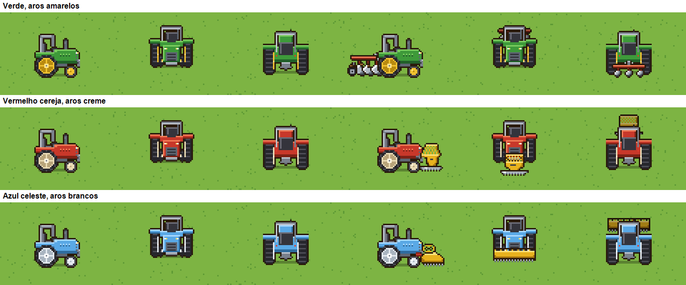

## Contents
- [Overview](#overview)
- [Screenshots](#screenshots)
- [Implements](#implements)
- [How to use](#how-to-use)
- [Configuration](#configuration)
- [Requirements and installation](#requirements-and-installation)
- [Compatibility](#compatibility)
- [For developers](#for-developers)
- [Credits and license](#credits-and-license)

## Overview
- **Buy the tractor as usual** (Robin, *Tractor Garage*). Without an implement it only drives: the tool in your hand does
  nothing while riding.
- **Buy implements** at Robin's shop (their own shop tab with Compact Searchable Shop Menu) and **upgrade** them in Clint's
  *Upgrade tools* menu.
- **Attach an implement** in the blueprint hitch menu (press <kbd>I</kbd> while riding): click it or drag it onto the
  tractor. It slides into place and locks with a metal clank.
- **Getting off the tractor always gives the implement back** — dismounting, warping, cutscenes, passing out or sending the
  tractor home. If your inventory is full, it drops on the ground at your feet. It is never lost.
- **New art:** a new compact tractor in three colours, a new garage, implement sprites for every direction and level,
  inventory icons, work effects (dust, wood chips, sparks, seeds, water, leaves) and working animations (spinning saw and
  blades, turning reel, moving belt, hammering rock breaker…). The water tank visibly empties as you use it.

## Screenshots
| | |
|---|---|
| Implements on the tractor in every direction | 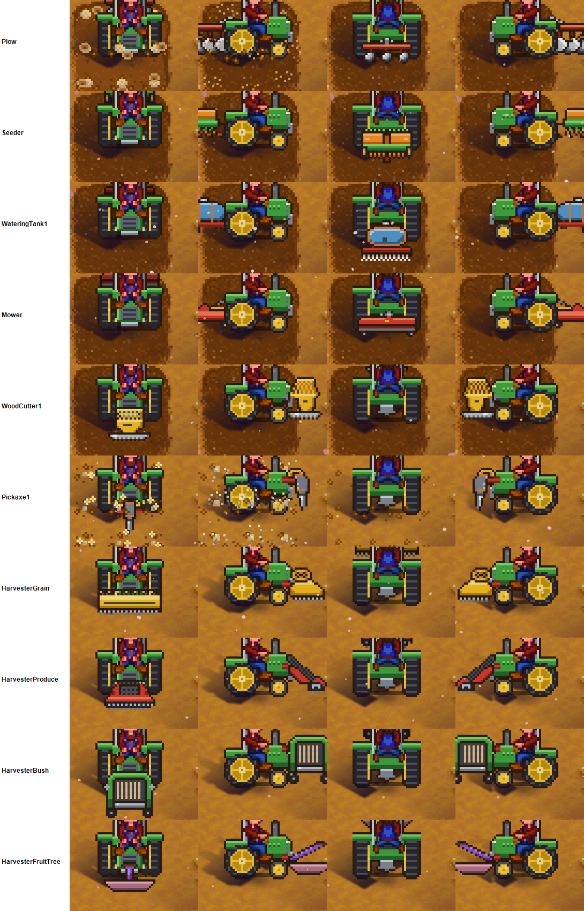 |
| Blueprint hitch menu | 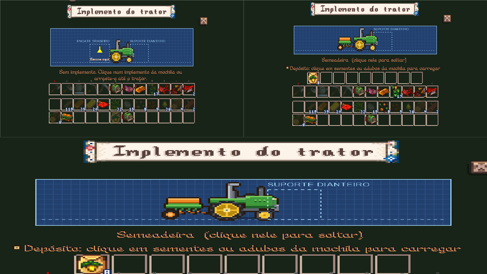 |
| Working animations and the tank emptying (frames) | 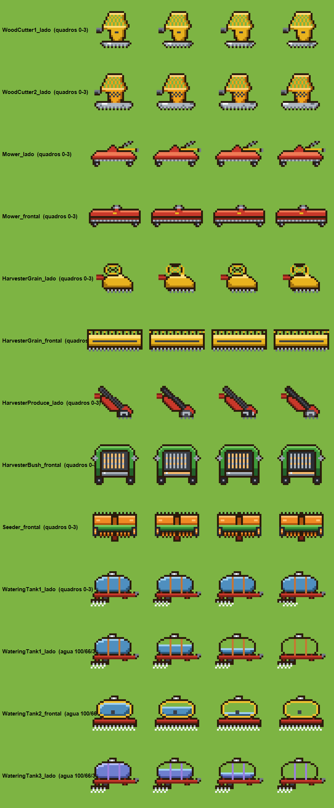 |
| Work effects | 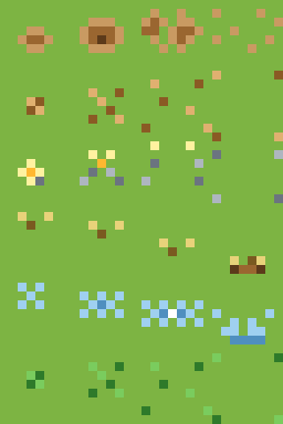 |
| Garage colours | 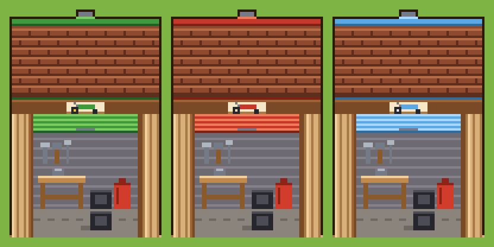 |
| Implements tab in Robin's shop (Compact Searchable Shop Menu) | 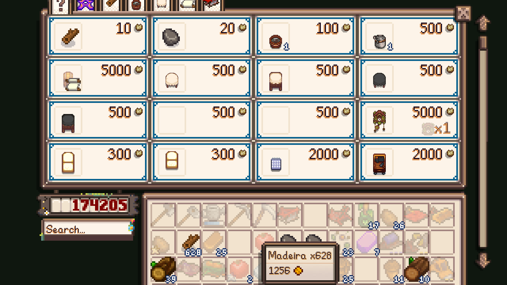 |

> GIFs: record the tractor working and attaching an implement and add them to `docs/gifs/` (placeholders:
> `docs/gifs/working.gif`, `docs/gifs/attach.gif`).

## Implements
Prices and materials are the defaults and can be changed in `config.json` (`ImplementPrices`). Base implements are sold by
**Robin**; level upgrades are in **Clint's *Upgrade tools* menu** and require the previous level in your inventory (it's
exchanged for the new one).

Mounted **behind** the tractor (3-point hitch): plow, seeder, water tank, mower. Mounted **in front**: wood cutter, rock
breaker and the four harvesters.

| Icon | Sprite | Implement | What it does | Price (default) | Rules |
|---|---|---|---|---|---|
| 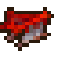 | 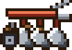 | **Plow** | Tills soil, clears weeds, digs artifact and seed spots. | 10,000g + 10 iron bars (Robin) | — |
| 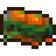 | 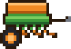 | **Seeder** | Fertilizes, then plants, from its 9-slot hopper. | 25,000g + 10 iron bars (Robin) | Accepts crop seeds (including mod seeds) and fertilizers (including tree fertilizer). Not saplings or tree seeds. Normal planting rules apply (season, rice near water…). |
| 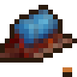 | 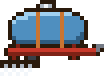 | **Water tank** (level 1, copper) | Waters crops and cools lava. | 15,000g + 10 copper bars (Robin) | Holds water for 200 tiles. Refill: face water and right-click; a pipe drops into the water and the tank fills in 5 seconds. |
| 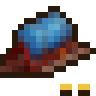 |  | Water tank level 2 (gold) | As above. | 30,000g + 10 gold bars (Clint) | 400 tiles. |
| 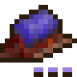 | 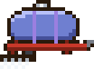 | Water tank level 3 (iridium) | As above. | 60,000g + 5 iridium bars (Clint) | 800 tiles. |
| 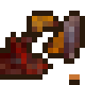 | 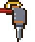 | **Rock breaker** (level 1) | Breaks stones and ore. | 15,000g + 10 iron bars (Robin) | Copper level: no boulders or meteorites. |
| 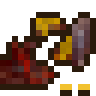 | 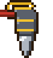 | Heavy rock breaker (level 2) | Also boulders and meteorites. | 40,000g + 5 gold bars (Clint) | Gold level. |
| 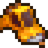 |  | **Wood cutter** (level 1) | Cuts wild trees at every growth stage, tree stumps and twigs. | 15,000g + 10 iron bars (Robin) | Never cuts fruit trees or tapped trees. Can't break large stumps or hollow logs. |
| 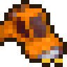 | 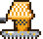 | Heavy wood cutter (level 2) | Also large stumps and hollow logs. | 40,000g + 5 gold bars (Clint) | Gold blade. Never fruit trees. |
| 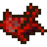 | 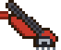 | **Produce harvester** | Harvests vegetables, fruit crops, flowers, herbs, beans and spawned forage. | 20,000g + 5 gold bars (Robin) | Leaves grains and trees. |
| 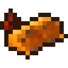 |  | **Grain harvester** | Harvests grains: wheat, corn, rice, amaranth and mod grains. | 20,000g + 5 gold bars (Robin) | A grain is a crop whose harvest has the `grain_item`, `rice_item` or `wheat_item` context tag, or is listed in `GrainCrops`. |
| 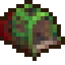 |  | **Bush harvester** | Harvests tea bushes, berry bushes and Custom Bush bushes. | 15,000g + 5 gold bars (Robin) | Leaves crops. |
| 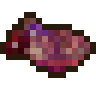 | 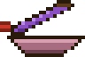 | **Fruit tree harvester** | Shakes fruit trees and palm trees for their fruit. | 25,000g + 5 gold bars (Robin) | Doesn't cut anything. |
| 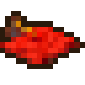 | 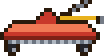 | **Mower** | Cuts weeds, grass and green rain bushes. | 5,000g + 5 copper bars (Robin) | Leaves crops. |

Weapons, the milk pail, shears and the slingshot still work from your hand, as in the original Tractor Mod.

## How to use
1. Build the *Tractor Garage* with Robin (150,000g + 20 iron bars, 5 iridium bars, 5 battery packs by default).
2. Buy an implement from Robin.
3. Ride the tractor and press <kbd>I</kbd> to open the hitch menu. Click the implement in your backpack, or drag it onto the
   tractor. Click the attached implement to remove it.
4. With the seeder attached, click seeds or fertilizer in your backpack to load the hopper; click a hopper slot to take it
   back.
5. With the water tank attached, face water and right-click to refill it. A blue gauge above the tractor shows the water.

Default keys: summon/dismiss the tractor <kbd>Backspace</kbd>, hitch menu <kbd>I</kbd>.

## Configuration
Edit `config.json` in the mod folder (created on first launch), or use
[Generic Mod Config Menu](https://www.nexusmods.com/stardewvalley/mods/5098) in game.

### Main options
| Key | Type | Default | Effect |
|---|---|---|---|
| `TractorSkin` | text | `Green` | Tractor (and garage) colour: `Green` (yellow rims), `Red` (cream rims), `Blue` (white rims) or `Original` (Tractor Mod's sprite). Changes immediately. |
| `ShowImplementEffects` | true/false | `true` | Small effects while implements work (dust, chips, sparks, seeds, water, leaves). |
| `TractorSpeed` | number | `-4` | Speed buff while riding (negative is slower). |
| `Distance` | number | `1` | Tiles worked around the tractor in each direction (1 = 3×3 area). |
| `MagneticRadius` | number | `384` | Item pickup radius while riding. |
| `InvincibleOnTractor` | true/false | `true` | You can't be hurt while riding. |
| `HighlightRadius` | true/false | `false` | Always show the work area. |
| `SoundEffects` | text | `Tractor` | `Tractor`, `Horse` or `None`. |
| `SoundEffectsVolume` | number | `75` | Engine volume (0–100). |
| `ToolUseSoundLimit` | text | `Default` | Limit how many tool sounds play at once. |
| `BuildPrice` | number | `150000` | Garage price. |
| `RequireBuildMaterials` | true/false | `true` | Whether the garage needs `BuildMaterials`. |
| `BuildMaterials` | item → amount | 20 iron bars, 5 iridium bars, 5 battery packs | Garage materials. |
| `CanSummonWithoutGarage` | true/false | `false` | Summon a temporary tractor without a garage. |
| `ImplementPrices` | implement → { Price, MaterialId, MaterialAmount } | see [Implements](#implements) | Price and material of each implement. |
| `WaterTankCapacity` | numbers | `[200, 400, 800]` | Tiles each tank level can water. |
| `InfiniteWater` | true/false | `false` | Tanks never run out. |
| `GrainCrops` | item IDs | `["(O)271", "(O)BFV.FruitVeggie_Blue_Corn", "(O)BFV.FruitVeggie_Oats"]` | Extra harvest items counted as grain. |
| `CustomAttachments` | item names | `[]` | Extra held items/tools to use from the hand (original Tractor Mod feature). |

### Controls (`Controls`)
| Key | Default | Effect |
|---|---|---|
| `SummonTractor` | `Backspace` | Summon the tractor. |
| `DismissTractor` | `Backspace` | Send the tractor home (while riding). The implement goes back to you. |
| `OpenImplementMenu` | `I` | Open the hitch menu while riding. |
| `HoldToActivate` | (none) | If set, the tractor only works while this key is held. |
| `IncreaseDistance` / `ReduceDistance` | (none) | Temporarily change the work area. |

### Implement behaviour (`StandardAttachments`)
These are the original Tractor Mod tool options; implements use them unless noted in [Implements](#implements) (for
example the wood cutter and the harvesters have their own rules).

| Section | Keys (default) |
|---|---|
| `Axe` (wood cutter) | `ClearDebris` (true), `CutGiantCrops` (true), `CutBushes` (false), `ClearDeadCrops` (true), `ClearLiveCrops` (false). Tree options are ignored by the wood cutter (it always cuts wild trees and never fruit trees). |
| `Hoe` (plow) | `TillDirt` (true), `ClearWeeds` (true), `DigArtifactSpots` (true), `DigSeedSpots` (true), `HarvestGinger` (true). |
| `PickAxe` (rock breaker) | `ClearDebris` (true), `ClearDeadCrops` (true), `ClearDirt` (true), `ClearDirtWithFertilizer` (false), `ClearFlooring` (false), `ClearBouldersAndMeteorites` (true), `ClearObjects` (false), `ClearWeeds` (true), `BreakMineStones` (true), `BreakMineContainers` (true), `HarvestMineSpawns` (true). |
| `Scythe` (harvesters, mower) | `HarvestCrops`, `HarvestFlowers`, `HarvestForage`, `HarvestFruitTrees`, `HarvestGreenRainBushes`, `HarvestTreeMoss`, `HarvestTreeSeeds`, `HarvestNonBlueGrass`, `HarvestBlueGrass`, `ClearDeadCrops`, `ClearWeeds` (all true), `HarvestMachines` (false). |
| `Seeds`, `Fertilizer`, `GrassStarter`, `WateringCan`, `SeedBagMod` | `Enable` (true). |
| `MilkPail`, `Shears`, `Slingshot`, `MeleeBlunt`, `MeleeDagger`, `MeleeSword` | Held-item features from the original mod (`Slingshot.Enable` false, `AttackMonsters` false). |

## Requirements and installation
1. Install [SMAPI](https://smapi.io/) 4.1.10 or later (Stardew Valley 1.6.15 or later).
2. Download the mod and unzip it into `Stardew Valley/Mods`, so you get `Mods/TractorModExpanded/`.
3. **Remove or disable Tractor Mod by Pathoschild** (`Mods/TractorMod`): TractorMod Expanded replaces it and they can't run
   together. Your tractor and garage keep working.
4. Run the game through SMAPI.

**Required:** SMAPI only.

**Optional integrations** (declared as optional dependencies in `manifest.json`):
| Mod | What it adds |
|---|---|
| [Generic Mod Config Menu](https://www.nexusmods.com/stardewvalley/mods/5098) (`spacechase0.GenericModConfigMenu`) | In-game settings. |
| [Item Extensions](https://www.nexusmods.com/stardewvalley/mods/20357) (`mistyspring.ItemExtensions`) | Its custom seeds and resource nodes work with the tractor (TractorMod Expanded applies Item Extensions' tractor integration itself). |
| [Compact Searchable Shop Menu](https://www.nexusmods.com/stardewvalley/mods/33271) (`mushymato.CompactSearchableShopMenu`) | Implements get their own tab in Robin's shop. |
| Iconic Framework (`furyx639.ToolbarIcons`) | Toolbar button to summon the tractor. |

## Compatibility
- Works in single player. Multiplayer: every player needs TractorMod Expanded; the host must have version 1.0.0 or later.
- Saves from Tractor Mod work: the tractor and garage use the same save data keys.
- Custom-seed mods that use the vanilla crop data (Cornucopia, SVE, etc.) work with the seeder.
- With CJB Cheats Menu's *Auto water* enabled, all tilled soil is already watered, so the water tank has nothing to do.

## For developers
Repository layout:
```
TractorModExpanded/
├─ README.md, LICENSE, .gitignore, TractorModExpanded.sln
├─ src/
│  ├─ Directory.Build.props, Directory.Packages.props
│  ├─ Common/                    shared code from Pathoschild's StardewMods
│  └─ TractorModExpanded/            the mod project (C#, manifest.json, assets/, i18n/)
│     └─ Framework/Implements/   implements: data, manager, menu, renderer, animator, effects, water tank, seeder hopper
├─ art/                          pixel-art sources (text maps) and the scripts that render the sprites
├─ docs/                         README images (sprites, screenshots)
├─ testes/                       automated in-game test runner script
└─ tools/package.ps1             builds the Nexus package
```

Build (Windows, .NET SDK 10; the project targets .NET 6 like the game):
```
dotnet build src/TractorModExpanded/TractorModExpanded.csproj -c Release "-p:GamePath=<path to Stardew Valley>"
```
Package for Nexus: `tools/package.ps1` → `releases/TractorMod Expanded v<version>.zip`.

Automated tests: `testes/rodar-testes.sh` (Git Bash) starts the game, loads a test save without ever saving it, runs the
in-game tests in `Framework/Testing/TestRunner.cs`, takes screenshots and closes the game. The test runner only runs when a
fresh `test-mode.json` exists in the mod folder (created and removed by the script; stale files are ignored).
Set the test save's folder name in `testes/test-save.txt` (not versioned) or the `TEST_SAVE` environment variable.
The inventory icons (`art/icones.ps1`) are built from source images in `art/icon-sources/` (not versioned).

## Credits and license
- **Tractor Mod** and **SMAPI** were created by **Pathoschild** (Jesse Plamondon-Willard); Tractor Mod versions before 4.0
  by PhthaloBlue. Original mod: <https://github.com/Pathoschild/StardewMods/tree/stable/TractorMod>. TractorMod Expanded is a
  derivative of Tractor Mod 4.24.4 and keeps its base: the tractor, the garage, the summon/dismiss system, the tool
  attachments, audio, the config menu and the shared `Common` code.
- **New in TractorMod Expanded** (by appendriel): the implement system (items, shops, upgrades at Clint, hitch menu with
  drag and drop, automatic return on dismount), the per-implement rules (wood cutter growth stages and fruit-tree
  protection, grain/produce/bush/fruit-tree harvesters, mower, seeder hopper, water tank with refill and gauge), the new
  tractor and garage sprites in three colours, implement sprites for every direction and level, inventory icons, work effects
  and animations, the Item Extensions bridge, and the automated in-game tests.
- Inventory icon art based on images created by the author with Google Gemini.
- License: [MIT](LICENSE). The original copyright notices are kept, as the license requires.
